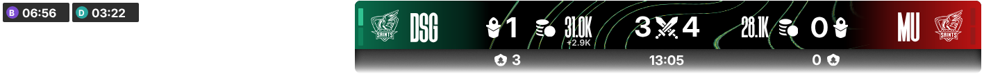

# League HUD (SCC)

A live, LCS-style top bar for League of Legends broadcasts. It reads the game while you spectate and gives you the numbers two ways:

1. **A ready-made overlay**: a 1920×1080 browser source built from `design/lol-hud-SCC27.psd`, using the same positions and fonts. Drop it into OBS or vMix and you're done.
2. **Data for vMix / GT Title Designer**: a CSV (plus JSON and XML) that updates every second, as a file and as a URL, so you can drive your own GT title.

It also has a control panel for team names, logos, series score and sides.



## What it shows

| On the bar | Field name(s) |
|---|---|
| Team tricode, logo, colour | `TRI-CODE LEFT`, `LOGO LEFT`, `COLOR LEFT` (hex, e.g. #0a6d4c) (and `RIGHT`) |
| Turrets destroyed | `TURRETS LEFT` |
| Team gold, and the lead | `GOLD LEFT` (31.0K), `GOLD RAW LEFT` (31012), `GOLD DIFF LEFT` (+2.9K, only on the leading side) |
| Kills | `KILLS LEFT` |
| Game clock | `TIMER` |
| Dragons, Rift Heralds, void grubs (lower strip) | `DRAGONS LEFT`, `HERALDS LEFT`, `VOID GRUB LEFT` |
| Series pips | `BO3 1 LEFT` (image path, lit when won), `BO3 1 LEFT WIN` (1/0) |
| Objective timers | `NEXT GRUBS`, `NEXT DRAGON`, `NEXT HERALD`, `NEXT ELDER`, `NEXT BARON`: countdown, `LIVE`, or blank once the objective is gone for the game (elder: blank until a team takes soul). Also blank when switched off in the control panel. `NEXT DRAGON IS ELDER` |
| Buffs | `BARON BUFF SIDE`, `BARON BUFF TIME`, `ELDER BUFF SIDE`, `ELDER BUFF TIME` |
| Other objectives | `DRAGONS LEFT`, `DRAGON TYPES LEFT` (Infernal,Ocean), `HERALDS`, `BARONS`, `ELDERS`, `ATAKHANS`, `INHIBS` |
| Players 1–5 left, 6–10 right | `P1 NAME`, `P1 CHAMPION`, `P1 CHAMPION ICON`, `P1 LEVEL`, `P1 KDA`, `P1 CS`, `P1 DEAD`, `P1 RESPAWN` |

The field names match your PSD layer names (`KILLS LEFT`, `GOLD LEFT`, `TRI-CODE LEFT`, `TIMER`, `VOID GRUB LEFT`…), so if you build the GT title from the PSD the names already line up.

## Windows desktop app

**Install:** download and run **[SCC-LoL-HUD-Setup.exe](https://github.com/owenbparker/LeagueHUDSCC/releases/latest/download/SCC-LoL-HUD-Setup.exe)**. It downloads the latest version from GitHub, installs it to `C:\SCC LoL HUD` (creating the folder), adds a **SCC LoL HUD** desktop shortcut and Start-menu entry, and offers to launch it. No administrator rights or Python needed. Windows may show "Windows protected your PC" the first time, as the installer isn't code-signed: **More info -> Run anyway**.

Running the installer again reinstalls the latest version and keeps your settings, logos and HUD profiles. Uninstall from Windows Settings -> Apps; it asks whether to also delete your settings.

Prefer no installer? Download **LeagueHUD-windows.zip** from the latest release, extract it anywhere and run `LeagueHUD.exe`.

**Updates:** every build is published as a GitHub release (v1.0.N). On launch the app checks for a newer one; when there is, an **Update to v1.0.N** button appears in the top bar. It downloads the release (checking GitHub's checksum), closes the app, swaps in the new files and reopens it in about 10 seconds. Settings, logos and output files are kept. **Check for updates** (in the same place on every screen) checks again.

The app opens on a choice of client (switch any time with **Change client** in the top right). Updates can be installed from both screens:

- **GFX Controller:** runs the HUD (everything below). Use it on the PC that makes the graphics.
- **Observer Client:** for an observer PC. Type the GFX PC's address (shown on the GFX PC under **Outputs -> From another PC**, e.g. `http://192.168.2.40:8777/overlay`) and click **Show HUD on game** to draw that PC's HUD over League here. On the GFX PC, tick **Let other PCs on the network read the HUD**. The observer client doesn't read the game itself; the GFX PC does. It can read this PC's screen to switch the webcams (see [Webcams](#webcams)).

**Show HUD on game** (in both clients) opens the HUD in a borderless, see-through window covering a whole screen, on top of League. Only the HUD shows, and clicks pass through to the game. Run League in **Borderless** or **Windowed** mode (exclusive Fullscreen draws over every other window). With more than one screen, a drop-down next to the button picks which. The HUD scales to the screen's size. It works with Windows in light or dark mode; if the window ever isn't see-through or doesn't cover the screen, the GFX Controller's Log says which step failed.

The GFX Controller has everything that used to be in the command window built in:

- **Live game / Demo game** switch (and demo speed) in the top bar, and **Show HUD on game**.
- **Outputs:** copy the overlay and vMix URLs, open the output folder, and let other PCs on your network read the HUD (they can read it, but only this PC can change settings).
- **Log:** game connected/disconnected, errors, new game events.

Closing the window stops the HUD. It needs Microsoft Edge WebView2, which is built into Windows 10 and 11; if it's missing, the control panel opens in your browser instead.

Settings (`config.json`), uploaded logos (`logos\`) and output files (`output\`) live next to `LeagueHUD.exe`.

### Running from source instead

With Python installed, `start-hud.bat` / `start-demo.bat` run it in a command window with the control panel in your browser. For the desktop window from source: `pip install pywebview`, then `python -m lolhud.gui`.

## Setup

You need **Python 3.9 or newer** ([python.org](https://www.python.org/downloads/); tick "Add Python to PATH" when installing). Nothing else to install.

Run it on **the PC that is spectating the game**. League only shares live game data with the machine running the game client.

- **Try it without League:** double-click `start-demo.bat`. It plays a simulated game so you can set up your scenes.
- **For a real game:** double-click `start-hud.bat`, then spectate (or replay) the match.

Then open the control panel at <http://localhost:8777/control>.

From a terminal: `python -m lolhud` (or `python -m lolhud --demo`) runs it without a window. `LeagueHUD.exe` and `python -m lolhud.gui` take the same options. Options: `--port 8777`, `--host 0.0.0.0` (lets other PCs on your network read it), `--demo-speed 8`, `--replay saved_allgamedata.json`.

## Option A: the built-in overlay (OBS or vMix)

Add a **Browser** source / **Web Browser** input:

- URL: `http://localhost:8777/overlay`
- Size: 1920 × 1080, transparent background

Optional switches on the end of the URL:

| | |
|---|---|
| `?timers=0` | hide all objective timers in the top left (to hide individual ones, use the control panel) |
| `?diff=0` | hide the gold-lead tab (it slides out in the leading team's colour under their gold, and back in when the lead flips or disappears) |
| `?dragons=1` | show each team's dragons as coloured dots in the lower strip |
| `?idle=0` | hide the bar when no game is running |

Combine them with `&`, e.g. `/overlay?timers=0&dragons=1`. The team panels, the bar's background lines (blending from one team's colour to the other) and the series pips all follow the team colours set in the control panel. The clock ticks smoothly and freezes if the game is paused.

## Option B: GT Title Designer + vMix Data Sources

1. In GT Title Designer, build your title. Easiest: import `design/lol-hud-SCC27.psd` and keep the layer names.
2. In vMix: **Settings → Data Sources → Add**, then either:
   - **Excel/CSV**: point it at `output\hud.csv` inside this folder, or
   - **JSON** (or **XML**): URL `http://localhost:8777/hud.json` (or `/hud.xml`).
   Set the refresh to 1 second.
3. Open your title's **Data Source** bindings and connect each field. Logos and series pips are image paths, so bind them to image layers.

The CSV is one header row plus one data row. The file is swapped in whole each time, so vMix never reads half a file. In XML, spaces and dashes in field names become `_` (`TRI_CODE_LEFT`).

If vMix runs on a different PC, start the HUD with `--host 0.0.0.0` and use `http://<spectating-PC-IP>:8777/hud.json`.

## HUD profiles (designs)

Two built in: **SCC 2026** plays a looping background video inside the bar (behind the numbers, icons and team panels) and **SCC 2026 - Static** is the original look. SCC 2026 comes with the SCC background loop already playing. With SCC 2026 selected, the HUD profile section has **Background video: Choose video…** to use your own (an .mp4 or .webm, copied into `media\` next to the app, so it's chosen once and isn't part of updates), **Use default loop** to go back to the SCC loop, **Remove** for the static lines, a **Playback speed** slider (0.1x-3x, live), **Tint with team colours** (on by default: the video is shown in greyscale with the team colours blended left to right over it, like the static lines) and a **Brightness** slider (20%-250%, live) for the video lines. If the video can't play, SCC 2026 shows the static lines instead.


The overlay draws whichever **HUD profile** is picked in the control panel. **SCC 2026** is built in; more can be imported from Photoshop with **Import PSD…**. Every feature (team colours, logos, pips, gold-lead tab, timers, objective counters) keeps working with any design, as long as the PSD's layers are named after what they show:

| Layer name | Becomes |
|---|---|
| A text layer named after a live field: `KILLS LEFT`, `GOLD RIGHT`, `TIMER`, `TRI-CODE LEFT`, `TURRETS LEFT`, `DRAGONS LEFT`, `TEAM NAME RIGHT`… (anything in the Live fields list) | Live text, in that layer's font, size, colour, alignment and caps |
| `TEAM LEFT` / `TEAM RIGHT` | Filled with the team colour |
| `TEAM LOGO LEFT` / `LOGO RIGHT` | Where the team logo goes |
| `BO3 1 LEFT`, `BO3 2 LEFT`, … (a `WIN` copy is fine) | Series pips |
| `LINES` *(optional)* | Artwork tinted from the left team's colour to the right's |
| `GOLD DIFF LEFT` / `RIGHT` *(optional)* | Where the gold-lead tab hangs (otherwise under the gold) |
| `OBJECTIVE TIMERS` *(optional)* | Top-left corner of the objective timers |
| `DRAGONS ICON LEFT`, `HERALDS ICON LEFT`, `GRUBS ICON LEFT` *(optional)* | Icons that hide when that counter is switched off |
| Anything else | Artwork, flattened with Photoshop's blending and effects |

Text keeps the PSD's paragraph alignment, so right-align numbers that sit to the left of an icon (and vice versa) to have them grow away from it. Fonts aren't stored in PSDs: the importer finds them in Windows' fonts, and the import report lists any it can't find with an **Add font file…** button. Imported profiles live in `profiles\` next to the app; `/overlay?profile=ID` shows a particular one regardless of the selection.

## The control panel

- **Teams:** tricode, name, logo (upload or pick), team colour (colour picker, or type a hex code), series wins (+/−).
- **Logo size & position:** sliders to scale a logo (40–250%) and nudge it left/right and up/down, for logos with lots of empty space or odd shapes. The tweak is saved against the logo file, so it follows that logo to either side and comes back whenever you pick it again. The tweak only applies to the built-in overlay; a vMix/GT title sizes the `LOGO` image itself.
- **Swap teams left/right:** swaps names, logos and scores.
- **Left team is on red side:** by default the left of the bar is blue side. Tick this when the left team plays red.
- **Series:** Bo1 / Bo3 / Bo5 (pips follow).
- **Players:** links each player in the game to their player in the team's roster on the connected GFX Engine (Teams > Team members). Next to each player: **linked** (green, with who) or **unlinked** (red), and **Save IGN to player**, a list of that team's members: picking one saves the in-game name as their In-game ID on the engine. Linked players show on the engine's graphics with their player name, headshot and flag.
- **Claimed objectives:** switch each team's dragon, Rift Herald and void grub counters in the HUD on or off.
- **Objective timers:** switch Void Grubs, Dragon, Rift Herald, Elder Drake and Baron on or off. Each shows while its objective is counting down or up, and drops off once it's gone for the game; the rest close up. They follow the designer's objective-timer design (`web/assets/objectives/`): counting down, a dark box with the objective's icon on a tinted tile and the time; once it's up, just the icon.
- **Next dragon:** the dragon timer shows the next dragon's element. **Automatic** knows it once the rift has formed (the third dragon's element; every dragon after it is the same). Until then it shows a grey dragon, or pick the element by hand.
- **Gold:** see below.
- A live preview, and every field with its current value (click a name to copy it).

Settings are saved to `config.json` and survive restarts.

## Scoreboard and bottom third

Both SCC 2026 profiles have the scoreboard along the bottom (from `design/lol-hud-SCC27.psd`): for each player the champion (greyed with a respawn countdown while dead), level, ultimate (dim until level 6), six items and trinket, summoner spells, keystone rune, role, name, CS, KDA and vision score, with the gold difference between the laners in the middle in the leading team's colour; plus the frames for the webcams, the sponsor logos and the minimap. Switch it off under **HUD Editor -> HUD profile**, or add `?scoreboard=0` to the overlay's address.

Riot's live game data doesn't include health, mana or other players' gold, so the health and mana bars are full while a player is alive and empty while dead, the level bar fills up to level 18, and the lane gold difference uses the HUD's gold estimate (see Gold). The layout comes from the PSD: after a design change, run `python tools/scoreboard_from_psd.py design/lol-hud-SCC27.psd` (needs `pip install psd-tools aggdraw`) to update `web/assets/scoreboard/`.

## Champ select (draft)

`/draft` is a browser source for champ select, read from the League client in the lobby on this PC or an Observer Client. Three looks (**Champ Select -> Draft look**):

- **SCC 2027 (fearless)**, from `design/DRAFT-HUD-SCC-2027.psd`: bans and coaches each side, a timer bar that runs down to the middle in the acting team's colour, the ban or pick being made lit up in the team's colour, ten pick cards, and the match in the middle (series score, team logos, tricodes, a sponsor line and the patch).
  **Fearless bans:** from the second game of a series, a panel above shows the champions each team played in the earlier games, by role (oldest first; the blue side's team on top). Each draft is added when the lobby closes with all ten picks in, and the list starts again when the series score goes back to 0-0. It's listed under Champ Select, where a game can be removed, the last draft added by hand, or the list cleared. The demo draft shows a sample.
- **LEC**, and **Europe** (RCVolus' lol-pick-ban-ui).

## Webcams

Each team gets a player cam along the bottom of the HUD, spaced like the LEC's: left cam at x 288-462, right cam at x 1458-1632, from y 821 to the bottom (174x259 each, set in `cams.slots` in `config.json`). Each one shows the player the action is on. The rest of the bottom section is left for your own design.

**Getting the cams in** (control panel -> **Webcams**, a row per player):
- **Player cam link, in a browser (least delay):** send players the **Player cam link** shown in the Webcams section (`https://<GFX PC>:8779/cam`; the plain `http://<GFX PC>:8777/cam` forwards there). They open it in Chrome or Edge, allow the camera, and pick their team and role. It's https because browsers only allow the camera on secure pages. The HUD makes its own certificate, so the first visit shows "Your connection isn't private": **Advanced -> Continue**.
- **SCC Player Cam app:** the same thing as a small app of its own, for players who'd rather not use a browser. Install it with **[SCC-Player-Cam-Setup.exe](https://github.com/owenbparker/LeagueHUDSCC/releases/latest/download/SCC-Player-Cam-Setup.exe)** (to `C:\SCC Player Cam`, with a desktop shortcut). Players enter the GFX PC's address (e.g. `192.168.2.40`). There's no certificate warning, it remembers their address, team, role and camera, and it updates itself like the HUD.

  Either way, the video goes straight from the player's PC to each overlay showing it, peer to peer over the local network (WebRTC), so there's no relay delay. The GFX PC must tick **Let other PCs on the network read the HUD**. Same network only. The tab or window can be minimised while they play. **Swap teams left/right** moves the cams with their teams.
- **Link:** paste a VDO.Ninja view link (or any page that shows just the cam) in the player's box. It works from anywhere, with VDO.Ninja's delay. For VDO.Ninja links the HUD adds `&cover&cleanoutput&noaudio`, so the cam fills its space without controls or sound. A link takes over from a player cam in the same seat.

The green dot shows which players have a cam. The row of the player on air is highlighted.

**Who's on camera:**
1. **Pin** keeps a team's cam on one player.
2. **Read this PC's screen** (Windows): reads the player name tags over the champions on League's screen and puts each team's cam on their player nearest the middle. Turn it on for the PC whose game goes to air: the GFX Controller, or the **Observer Client** (which tells the GFX PC). League must be in Borderless or Windowed. **Test screen read** shows what it found. It only looks between the top bar and the bottom HUD (`cams.director_area`). A player has to be seen twice running before the cam switches.
3. Otherwise the cams follow the **latest kill**: the killer's and the victim's cams, for 12 seconds.

**Delay the cams by** (2:30 by default) holds the player cams back to match League's spectator delay, so the players' reactions line up with the play on air. Each overlay records the cams and plays them back that late, so a cam appears that long after it connects. Set it to 0:00 for live cams. Links (VDO.Ninja) aren't delayed.

**Stay on a player at least** (3 s by default) stops the cams flicking between players. **Switch to the players in the action** off keeps the cams where they are. When the chosen player has no cam, the team's cam stays on the last player shown.

Add `?cams=0` to the overlay URL to leave the cams out of an overlay.

Cam links (VDO.Ninja) only play in a "secure" page: the overlay from this PC (`http://localhost:8777/overlay`) or over https. The Observer Client's HUD window uses the GFX PC's https address for this by itself. A browser source on another PC should use `https://<GFX PC>:8779/overlay`, not the `http://` one.

## Animations

**Animations** in the control panel:
- **First blood** (on by default): when a team draws first blood, a flash and a bright band wipe across from their end of the top bar. Their side fills with the team colour, reaching almost to the other team's colour, and "FIRST BLOOD" eases in beside their logo. Then the same wipe takes it away and the bar is back to normal, all in under 3 seconds. It's modelled on the Premier League's goal graphic.
- **Preview: left / right team:** plays it on the overlay right away, for checking the look before going live.

The animation plays once per game, and not again if the overlay reloads.

## About gold

League's game client doesn't share other players' gold (LCS gets it from Riot's private esports feed). The HUD offers four options:

- **Read from the spectator top bar** (default, Windows): the app captures the gold numbers ("8.0k") from the League window on the HUD PC twice a second and reads them with Windows' built-in text recognition. These are the same numbers your observers see. Keep the spectator top bar showing; borderless/windowed mode is the safest. Readings that don't make sense (gold going down, huge jumps) are ignored, and if the numbers can't be read for 5 seconds the HUD uses the estimate below until they can. The same reading also takes each team's **dragon, Rift Herald and void grub counts** from the top bar, because League's game data doesn't report every objective; if a counter can't be read, the game's events are used. Use **Test read** in the Gold section to see exactly what was captured and read. If your HUD scale puts the numbers somewhere else, adjust `gold_ocr_boxes` in `config.json` (x, y, width, height on a 1920x1080 screen).

- **Estimate:** works out earned gold from game time, CS, kills, assists, turrets and barons, and never goes below the value of the items a team holds. Usually within about 10%. If it runs high or low against the in-game scoreboard, change **Estimate adjustment** (e.g. 1.05). Passive gold is counted from 0:35 (`passive_gold_start` in `config.json`), matching the 2026 season.
- **Items:** the value of items held. Always a little low, since it ignores unspent gold.
- **Manual:** type the numbers in.

Item prices and champion icons come from Riot's Data Dragon. They are downloaded on first run and cached in `output/`.

## Things to check against the current patch

- Riot moves objective spawn times between seasons. Set them in `config.json` under `timers` (seconds). Defaults follow the 2026 season: dragon 5:00 (respawn 5:00), grubs 8:00 (one camp of three, gone at 14:45), herald 15:00 (once, gone at 19:45), baron 20:00 (respawn 6:00), elder 6:00 after soul and between elders.
- Void grubs and Atakhan are counted from any game event whose name contains "Horde"/"Grub" or "Atakhan". If Riot adds an event the HUD doesn't use yet, the control panel lists it under "New game events not used yet". Send it over and it can be added.

## Files

```
lolhud/          the app (Python standard library; the desktop window also uses pywebview)
  source.py        reads the game (Riot Live Client Data API) or runs the demo game
  state.py         turns game data into HUD fields
  gold.py          gold estimate + Data Dragon prices/icons
  ocr.py           reads team gold off the spectator top bar (Windows text recognition)
  cams.py          webcams: connects player cams to overlays, picks who's on camera, reads name tags
  tls.py           the https certificate for the player cam link
  camapp.py        the SCC Player Cam app (PlayerCam.py / PlayerCam.spec, installer/SCC-Player-Cam.iss)
  updater.py       checks GitHub releases and installs updates; version.py holds the build's version
  profiles.py      HUD profiles (built-in in web/profiles/, imported in profiles/)
  psd_import.py    turns a PSD into a HUD profile
  outputs.py       CSV / JSON / XML
  app.py           web server, control panel API
  gui.py           the desktop window (pywebview)
  log.py           the log shown in the app
web/overlay.html   the broadcast overlay
web/control.html   the control panel
web/overlay_cams.js the webcams in the overlay
web/cam.html       the player cam page (browser link and Player Cam app)
web/assets/        images exported from the PSD (bar, its background lines, team panels, logos, pips)
tools/split_bar.py rebuilds the bar and line images from design/hud_bar.png
web/fonts/         Heathergreen, Inter
design/            the original PSD
tests/             python -m unittest discover -s tests
LeagueHUD.py       desktop app entry point; LeagueHUD.spec builds the .exe (pyinstaller --noconfirm LeagueHUD.spec)
packaging/         app icon (icon.ico / icon.png)
.github/workflows/ builds the .exe on Windows for every push
```
